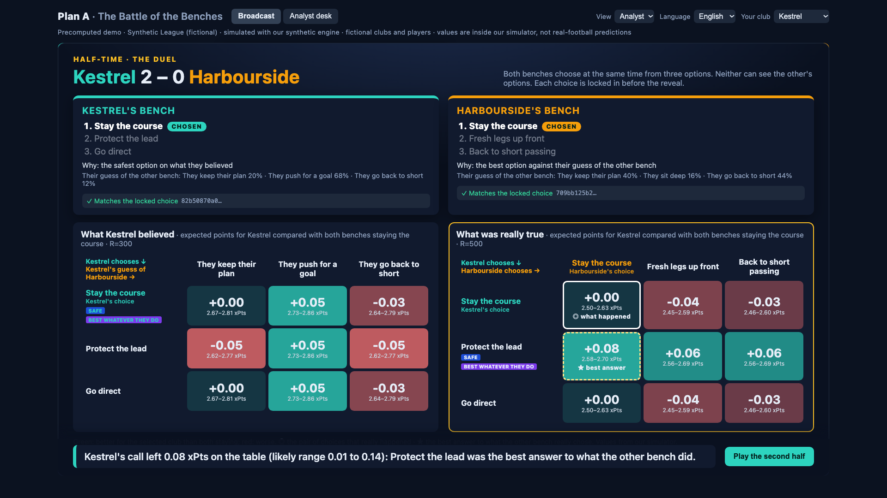

# Plan A: The Battle of the Benches

Two AI coaching staffs, each blind to the other's private information, scout a fictional opponent, seal a game plan
before kick-off and make a simultaneous half-time call. Every call is priced against the other bench's possible
answers with Monte Carlo forks of the same match, and after the reveal the broadcast shows what each bench believed
next to what was really true. Built for the Microsoft + Premier League *Inside the Game* hackathon.

> **Data statement.** All data is synthetic. Clubs and players are fictional. No Premier League data, names or marks
> are used. Every number is produced inside our own simulator and is not a prediction about real football.

**Demo:** <!-- DEMO_URL --> not deployed yet (ready for Azure Static Web Apps, `infra/AZURE_PLAN.md`). Run it
locally in two commands below, or watch [`docs/media/plan_a_demo_v2.mp4`](docs/media/plan_a_demo_v2.mp4) (117 s, captured
from the app; narration and timings in [`docs/VIDEO_SCRIPT.md`](docs/VIDEO_SCRIPT.md)).



## What you see

1. **Pre-match.** Each staff (an analyst and a manager agent) scouts the other club from 8 past matches through
   its own MCP tools, proposes plans, values them in simulation against its estimate of the opponent, and seals one
   (SHA-256, verified in your browser).
2. **First half.** A live Plan Tracker follows each plan's KPIs against the curve the staff expected; a detector
   flags when a team changes how it builds up.
3. **Half-time Duel.** Both benches choose at the same time from three options, without seeing each other's. Each
   prices a payoff matrix with *its own* beliefs and seals its choice (salted commit-reveal). Only after both seals
   does the broadcast price the true matrix.
4. **Full time.** Whose plan worked, which KPIs held, and the regret of each call: the xPts left on the table
   against the best answer to what the other bench really did, with an interval.

<!-- DEMO_STORY -->
**The demo match** (season 2026, match seed 236, agents: offline-rules/offline-rules): Kestrel 2-0 Harbourside at half-time, 2-2 at full time.
- Plans: Kestrel "Measured approach", Harbourside "Exploit their weaknesses".
- Kestrel changed its build-up at minute 25; the live detector flagged it at minute 37 (estimated change minute 26).
- Half-time: Kestrel chose "Stay the course" (safe pick on its own believed matrix).
- Half-time: Harbourside chose "Stay the course" (best guess on its own believed matrix).
- Kestrel: regret 0.076 xPts (paired 90% interval 0.012 to 0.144) against "Protect the lead"; "Protect the lead" was dominant in the true matrix.
- Harbourside: regret 0.03 xPts (paired 90% interval -0.032 to 0.098) against "Back to short passing".
<!-- /DEMO_STORY -->

This is one replay: it illustrates the decisions, it does not prove anything on its own; the half-time calls are
judged by the matrices, and the evaluation below measures them over many matches.

Deep links open any moment: `?t=45:00&reveal=1&mode=analyst`, `?t=45:00&reveal=1&matrix=believed`, `?t=90:00`,
`?tab=desk&section=validation`, `?tab=desk&lang=es&club=HAR`.

## Why it is agentic

Full design: [`docs/MULTI_AGENT.md`](docs/MULTI_AGENT.md). Every decision of the demo with the claims behind it:
[`docs/AGENT_EVIDENCE.md`](docs/AGENT_EVIDENCE.md) (generated from the bundle).

- **Two adversarial teams of agents with private information.** Each staff only reaches the world through MCP
  tools scoped to its club; the scope is fixed by the host, never by the request, and the other bench's options,
  matrix and choice are unreachable (tested). A bench anticipates the other from what it saw in the first half,
  never from the other team's real settings.
- **Commitments.** Plans and half-time choices are sealed before anything that could change them is revealed.
- **Grounded by construction.** Agents write `{claim_id.field}` placeholders, never digits; code fills them from
  claims and rejects any text that is not grounded. Plans must cite claims the staff actually retrieved.
- **Decisions under uncertainty, then accountability.** Believed vs true matrices and regret make each agent's
  reasoning checkable after the fact.

## Microsoft technology

| Piece | Status |
|---|---|
| Microsoft Agent Framework (`agent-framework-core` 1.23.0): analyst, manager and duel-bench agents with MCP tools | used in every run |
| Model Context Protocol (MCP SDK 2.3.0): one scoped server per club and one for the broadcast | used in every run |
| Microsoft Foundry (`agent-framework-foundry` 1.15.0, Entra ID pinned to one tenant, no keys): `AGENTS_MODE=foundry` | code path verified against a local mock of the Responses API (`tests/test_foundry_contract.py`); **no real Foundry deployment has been called yet** (`docs/FOUNDRY.md`) |
| Azure Static Web Apps (Free) for the public demo | config and guarded deploy script ready and checked in the SWA emulator; **not deployed yet** (`infra/AZURE_PLAN.md`) |

Without Azure, the same agents run with a deterministic offline rules client (`AGENTS_MODE=offline`), which is what
CI and the current demo bundle use; the bundle says which model produced it (`eval.build.models`).

## Results (inside our simulator)

Full tables: [`eval/results/RESULTS.md`](eval/results/RESULTS.md) (generated from the JSON results).

<!-- RESULTS_HEADLINE -->
| Test | What it measures | Result |
|---|---|---|
| E1 | Scouting reports vs hidden truth, 30 clubs in 5 unseen seasons with random trait kinds | precision 0.687, recall 0.633 (83 flagged, 90 real traits) |
| E2 | Monte Carlo noise: R=300 vs R=3000 for 6 lever changes from one half-time state | mean abs error 0.013 xPts; 90% CI covers the reference 0.667; sign agreement 0.333 overall, 0.5 on the 2 cells whose reference interval excludes zero |
| E3 | Plans that target a real hidden weakness (12 plans) | 0.75 vs 0.501 for a blind random plan; levers citing claims the staff retrieved 1.0 |
| E4 | Grounded text | reports valid at first try 1.0; cues dropped by the verifier 0; numbers written by the model 0 (by construction) |
| E7 | Probability a bench gave to what the other bench really did | 0.4 (90% CI 0.31 to 0.493, n 12); uniform guess 0.333 |
| E8 | Half-time regret (xPts lost vs the best answer to the other bench's real choice) | AI 0.028 (90% CI 0.013 to 0.047, n 12); always stay 0.045 (90% CI 0.031 to 0.064, n 12); random 0.029 (90% CI 0.02 to 0.039, n 12) |
| Duel | Half-times where the best answer depends on the other bench (no dominant option in the true matrix) | 0.5 of 12 bench decisions |
<!-- /RESULTS_HEADLINE -->

Reading them honestly: scouting (E1) and plans (E3) clearly beat blind baselines. The half-time calls do not yet:
the benches anticipate the other bench only slightly better than a uniform guess (E7, interval includes 0.333), and
their regret is lower than always staying the course but about the same as a random choice (E8).

How these were obtained: every threshold and simulator knob was chosen on **dev** seasons only (random trait kinds,
seeds 9001-9015 and 11-14); the **test** seasons (8001-8005 for E1, 8101 for the matches) were run once before and
once after the changes. Before/after table and every calibration: [`eval/results/RESULTS.md`](eval/results/RESULTS.md).
One change that made results worse on dev (a "what would they pick" step for E7) was measured and removed (D-051).

## Limitations

- **Synthetic world.** Clubs, players, hidden weaknesses and matches come from our simulator. The results show the
  agents are grounded and reproducible, and that their scouting and plans beat blind baselines *inside that
  world*; they say nothing about real football or real coaches.
- **A simple match model.** A zone-based simulator with five levers. Its season statistics are near, not always
  inside, the target ranges (passes and pass accuracy are off; 24-match samples are noisy). Pressing-based exploits
  do not pay off in it yet (D-051), and many half-time matrices still have a dominant option.
- **Small evaluation samples.** E7/E8 rest on 12 half-time decisions per run; intervals are reported.
- **Half-time options come from the sealed plan.** After a Plan B a bench can be offered an option that changes
  nothing: in the demo, Kestrel's "Go direct" has the same numbers as "Stay the course" because its Plan B already
  went direct at minute 25 (D-053). The fix touches the engine protocol and the evaluated numbers, so it is kept on
  a separate branch for the owners to decide.
- **Offline agents in the demo.** The committed demo was produced by the deterministic rules client. A Foundry run
  will change texts, plans and possibly the story; the bundle records which model produced it.
- **No live backend.** The public demo replays a precomputed bundle; the MCP server is not exposed.

## Run it

Requirements: [uv](https://docs.astral.sh/uv/) (installs Python 3.12) and Node.js 22+.

```bash
make setup        # .venv + Python and web dependencies
make web-dev      # http://localhost:5173 with the committed demo bundle, no backend
```

Rebuild everything from scratch (offline mode, about a minute per match on a laptop):

```bash
make bundle SEED=236        # season -> pre-match -> first half -> duel -> second half -> web/public/match_bundle.json
make seed-search N=48       # how the demo seed was chosen (criteria in pipeline/build.py, STORY_CRITERIA)
make eval                   # calibrations on dev seasons, E1-E8, eval/results/RESULTS.md
make check                  # lint, schemas, fixtures, tests
```

With Microsoft Foundry (needs your own subscription, see `docs/FOUNDRY.md`): set `FOUNDRY_PROJECT_ENDPOINT`,
`FOUNDRY_MODEL_SMALL` and `FOUNDRY_TENANT_ID` in `.env`, `az login --tenant <tenant>`, then `make foundry-check`
(no network), `make foundry-ping` (one call) and `AGENTS_MODE=foundry make bundle SEED=<seed>`.

## Layout

```
contracts/    Pydantic contracts (source of truth) -> JSON Schemas -> TypeScript types
sim/          Vectorised match simulator, synthetic season, render layer
engine/       Scouting claims, xG, plan valuation, Plan Tracker, adaptation detector, duel matrices, regret
mcp_server/   Scoped MCP tools (KES, HAR, broadcast); loopback only
agents/       Microsoft Agent Framework agents, offline rules client, validators, broadcast director
pipeline/     The only holder of the hidden truth: builds the demo bundle, seed search
eval/         Calibrations, E1-E8, results
web/          React + TypeScript + Vite app (static)
docs/         Architecture, multi-agent design, decisions, Foundry, submission, video script, media
infra/        Guarded Azure scripts (Foundry, Static Web Apps, teardown)
```

Architecture: [`docs/ARCHITECTURE.md`](docs/ARCHITECTURE.md). Every design decision and disclosure:
[`docs/DECISIONS.md`](docs/DECISIONS.md).

## Rules enforced by tests

- Engine, MCP server and agents never import the hidden truth (`contracts.eval_only`).
- A bench's private duel data never contains the true matrix or the other bench's options or choice.
- Plan seals and choice commits verify; salts are random; regret is non-negative and matches the true matrix.
- Every broadcast cue passes the text verifier; the bundle contains no hidden trait.
- The simulator's KPI counters equal the engine's event definitions; the same seed gives the same bundle in any
  process.
- The committed demo bundle is internally consistent (score, matrices, readings, regret, seals, KPI verdicts), and
  every number in this README's story block and in the video narration is in it (`tests/test_demo_consistency.py`).

## License

MIT, see `LICENSE`.
